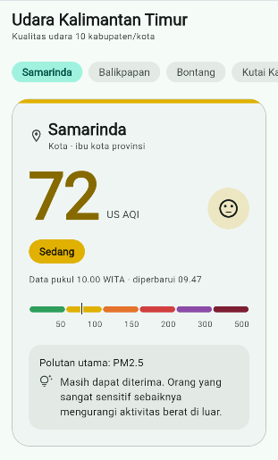
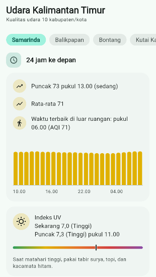
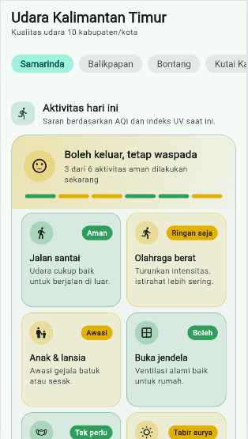
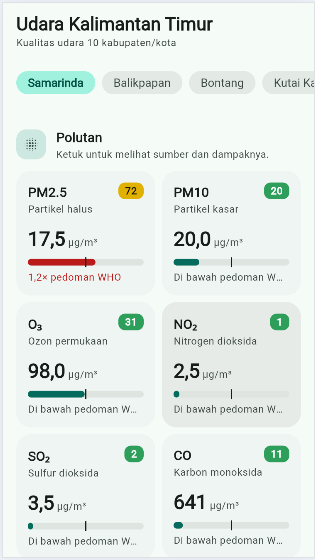
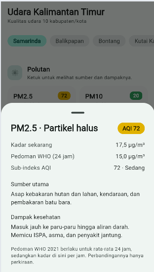
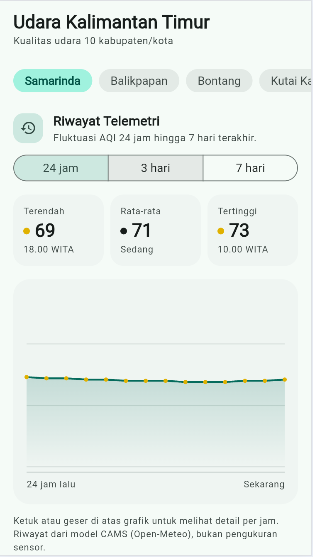
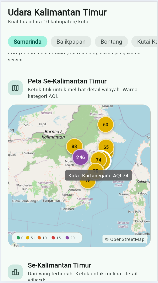
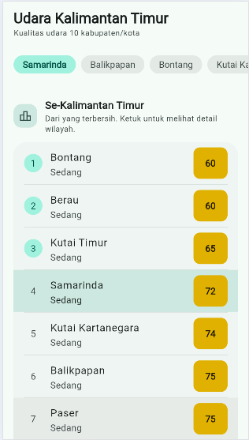
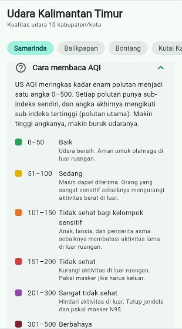
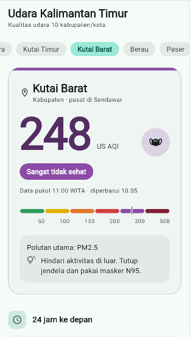

# Udara Kaltim

Aplikasi Flutter untuk memantau **kualitas udara** di 10 kabupaten/kota
**Kalimantan Timur**: Samarinda, Balikpapan, Bontang, Kutai Kartanegara,
Kutai Timur, Kutai Barat, Berau, Paser, Penajam Paser Utara, dan Mahakam Ulu.


## Tampilan

<p align="center"> 
   
  &nbsp; 
   
  &nbsp; 
   
  &nbsp; 
   
  &nbsp; 
   
</p> 
<p align="center"> 
   
  &nbsp;
   
  &nbsp;
   
  &nbsp; 
   
  &nbsp; 
   
</p>

## Fitur

| Bagian | Isi |
| :--- | :--- |
| Pilihan wilayah | *Chip* 10 kabupaten/kota Kaltim. Layar sempit: digeser ke samping (mouse dan trackpad juga didukung), *chip* terpilih otomatis digulir ke tengah. Layar ≥ 900 px: semua *chip* tampil membungkus |
| Indeks saat ini | Angka **US AQI** yang berhitung naik, kategori berwarna, **polutan utama**, skala 0–500 dengan penanda, saran kesehatan, jam data (WITA) |
| 24 jam ke depan | Puncak, rata-rata, **waktu terbaik untuk aktivitas luar** (06.00–17.00, hanya jika AQI ≤ 100), grafik batang per jam |
| Indeks UV | Nilai sekarang, puncak hari ini, skala warna, dan saran perlindungan |
| Aktivitas hari ini | Enam kotak saran (jalan santai, olahraga berat, anak & lansia, buka jendela, masker, paparan matahari) berwarna **Aman / Waspada / Hindari**, plus ringkasan dan strip segmen di kepala kartu |
| Polutan | PM2.5, PM10, O₃, NO₂, SO₂, CO: kadar μg/m³, warna sub-indeks, dan perbandingan dengan **pedoman WHO 2021**. Ketuk untuk melihat sumber dan dampak kesehatannya |
| Riwayat Telemetri | Pilih rentang **24 jam / 3 hari / 7 hari**. Kartu AQI terendah, rata-rata, dan tertinggi (beserta jamnya), serta grafik garis interaktif: ketuk atau geser untuk melihat AQI tiap jam |
| Peta Se-Kalimantan Timur | Peta OpenStreetMap dengan titik 10 wilayah berwarna kategori AQI dan legenda. Ketuk titik untuk berpindah wilayah |
| Se-Kalimantan Timur | Peringkat 10 wilayah dari yang terbersih; ketuk untuk berpindah wilayah |
| Cara membaca AQI | Penjelasan AQI dan arti setiap kategori (panel yang bisa dibuka) |
| Tema | Mengikuti tema terang/gelap perangkat; tata letak menyesuaikan layar sempit hingga sangat lebar |

Kategori mengikuti standar US AQI (EPA):

| AQI | Kategori |
| :---: | :--- |
| 0–50 | Baik |
| 51–100 | Sedang |
| 101–150 | Tidak sehat bagi kelompok sensitif |
| 151–200 | Tidak sehat |
| 201–300 | Sangat tidak sehat |
| 301–500 | Berbahaya |


## Arsitektur (MVVM)

Mengikuti pola Contoh 11, dengan satu folder per lapisan:

```text
lib/
├── main.dart                          # runApp + Provider (merangkai semua lapisan)
├── pemeriksaan.dart                   # jalankanUji() dengan MockClient
├── models/udara.dart                  # Kota, Kategori, Polutan, Udara, RingkasanKota,
│                                      # RentangRiwayat, TitikRiwayat, ...
├── services/layanan_open_meteo.dart   # LayananOpenMeteo, ApiException
├── repositories/repositori_udara.dart # RepositoriUdara, RepositoriUdaraOpenMeteo
├── viewmodels/udara_viewmodel.dart    # UdaraViewModel, StatusMuat, pesanRamah
└── views/
    ├── halaman_udara.dart             # AplikasiUdara, HalamanUdara, PilihanKota, IsiUdara
    ├── komponen_udara.dart            # KartuIndeks, GrafikPerJam, KartuUv, DaftarPolutan,
    │                                  # PeringkatKaltim, ArtiKategori, RiwayatTelemetri
    ├── peta_kaltim.dart               # PetaKaltim (flutter_map + penanda AQI)
    └── kartu_aktivitas.dart           # KartuAktivitas, susunAktivitas
```

| Lapisan | Kelas | Tugas |
| :--- | :--- | :--- |
| Model | `Kota`, `Kategori`, `Polutan`, `Udara`, `TitikRiwayat`, … | Data dan aturan kategori AQI; tidak tahu apa-apa soal HTTP atau tampilan |
| Service | `LayananOpenMeteo` | Membuat alamat dengan `Uri.https`, `GET` dengan batas waktu 10 detik, memeriksa kode status, `jsonDecode` |
| Repository | `RepositoriUdaraOpenMeteo` | JSON → model dengan *pattern matching*; menyatukan **larik sejajar** (`hourly.time[i]`, `hourly.us_aqi[i]`, …); nilai `null` tetap ditangani |
| ViewModel | `UdaraViewModel` | Detail wilayah dan peringkat diminta bersamaan (`Future.wait`), status memuat/berhasil/gagal, pesan galat ramah, nomor permintaan agar jawaban terlambat diabaikan, serta state riwayat (rentang dan data) |
| View | `KartuIndeks`, `GrafikPerJam`, `KartuAktivitas`, `RiwayatTelemetri`, `PetaKaltim`, … | `RefreshIndicator`, `context.select` untuk *chip*, *bottom sheet* detail polutan, `CustomPaint` untuk grafik garis, label semantik untuk pembaca layar |

Ada tiga jenis permintaan ke API:

```dart
// 1. Detail satu wilayah
Uri.https('air-quality-api.open-meteo.com', '/v1/air-quality', {
  'latitude': '-0.49',
  'longitude': '117.15',
  'current': 'us_aqi,uv_index,pm2_5,us_aqi_pm2_5,pm10,us_aqi_pm10,...',
  'hourly': 'us_aqi,uv_index',
  'timezone': 'auto',
  'forecast_hours': '24',
});

// 2. Peringkat dan peta: 10 koordinat dalam satu permintaan, jawabannya berupa daftar
Uri.https('air-quality-api.open-meteo.com', '/v1/air-quality', {
  'latitude': '-0.49,-1.27,0.13,...',
  'longitude': '117.15,116.83,117.49,...',
  'current': 'us_aqi',
  'timezone': 'auto',
});

// 3. Riwayat telemetri: AQI dan PM2.5 per jam untuk N hari ke belakang
Uri.https('air-quality-api.open-meteo.com', '/v1/air-quality', {
  'latitude': '-0.49',
  'longitude': '117.15',
  'hourly': 'us_aqi,pm2_5',
  'past_days': '7',
  'forecast_days': '0',
  'timezone': 'auto',
});
```

Data peringkat dipakai ulang oleh daftar peringkat dan peta, jadi peta tidak menambah permintaan. Riwayat dimuat setelah data utama berhasil, dan kegagalannya tidak menggagalkan layar utama (cukup tampil "Data riwayat belum tersedia").

## Pemeriksaan sebelum aplikasi tampil

`main` menjalankan `jalankanUji()` sebelum `runApp`. *Repository* dan ViewModel
diperiksa dengan `MockClient` (tanpa internet). Hasil di konsol:

```text
LULUS  Alamat memakai lintang wilayah
LULUS  AQI saat ini
LULUS  AQI 69 = Sedang
LULUS  Polutan utama PM2.5
LULUS  Ozon 69 (bulat) terbaca
LULUS  SO2 kosong
LULUS  Tiga jam prakiraan
LULUS  Jam kedua tidak sehat
LULUS  AQI jam ketiga kosong
LULUS  Peringkat: terbersih Bontang
LULUS  Peringkat: tanpa data paling akhir
Galat saat memuat kualitas udara: ApiException: kode status 500
LULUS  Kode 500: status gagal
LULUS  Kode 500: pesan ramah
```

Baris `Galat ... 500` memang diharapkan: uji ViewModel sengaja membuat server tiruan menjawab `500`.

## Menjalankan

```bash
flutter pub get
flutter run            # Android / Windows
flutter run -d chrome  # web (Open-Meteo mengizinkan CORS)
flutter test
```

Paket yang dipakai:

| Paket | Kegunaan |
| :--- | :--- |
| [`http`](https://pub.dev/packages/http) | Permintaan HTTP dan `MockClient` untuk pemeriksaan |
| [`provider`](https://pub.dev/packages/provider) | Penyedia dependensi dan state ViewModel |
| [`flutter_map`](https://pub.dev/packages/flutter_map) | Peta interaktif |
| [`latlong2`](https://pub.dev/packages/latlong2) | Tipe koordinat `LatLng` untuk peta |

Tambahkan ke `pubspec.yaml` bila belum ada:

```bash
flutter pub add http provider flutter_map latlong2
```

> Peta memakai tile publik OpenStreetMap. Permintaan tile butuh internet; saat offline, titik AQI tetap tampil di atas latar kosong.

## Sumber data

Data kualitas udara dari [Open-Meteo.com](https://open-meteo.com) (model CAMS), lisensi
[CC BY 4.0](https://creativecommons.org/licenses/by/4.0/). Nilainya adalah prakiraan
model per grid ±40 km, bukan hasil alat ukur di lapangan; riwayat telemetri juga berasal dari model yang sama, bukan sensor. Pedoman polutan dari
[WHO Global Air Quality Guidelines 2021](https://www.who.int/publications/i/item/9789240034228).
Peta © [OpenStreetMap](https://www.openstreetmap.org/copyright) contributors.